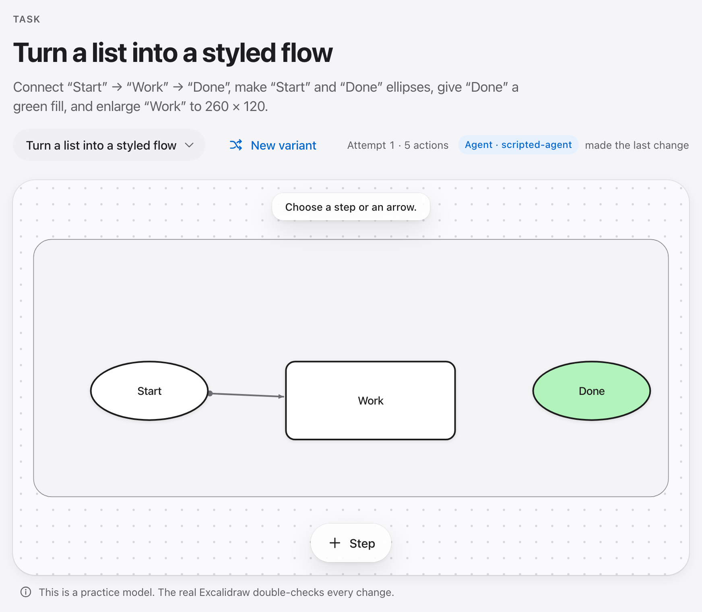
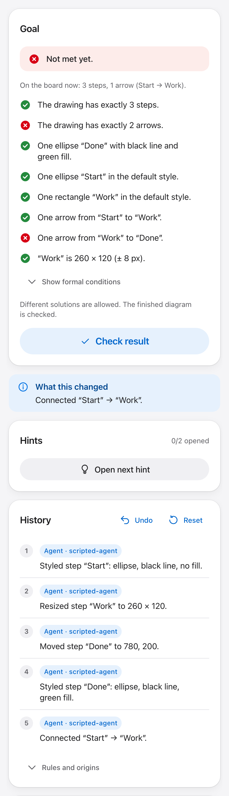
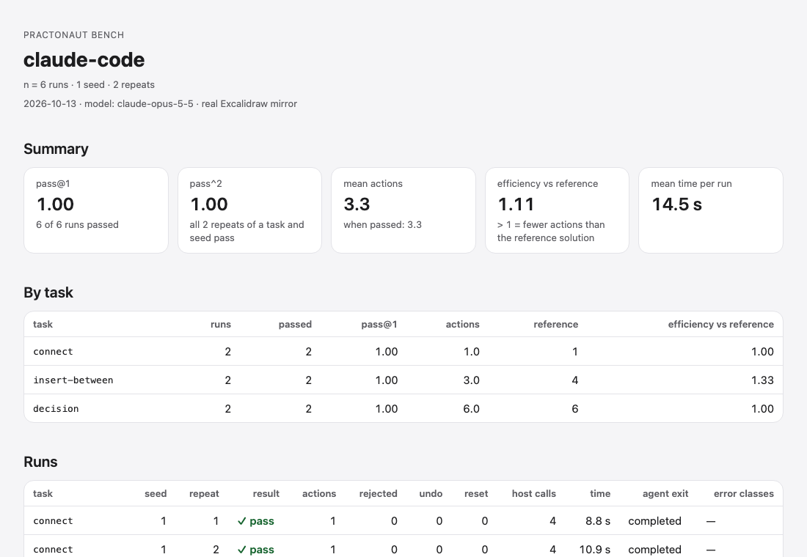

# Practonaut

**A local practice gym for AI agents on real apps.** Demonstrate a task once, let any MCP agent
practise it, and get an independent, reproducible score — one `npx` command, no VM, no Docker.

<picture>
  <source media="(prefers-color-scheme: dark)" srcset="docs/assets/player-dark.png">
  
</picture>

Practonaut turns a real application — today [Excalidraw](https://github.com/excalidraw/excalidraw) —
into a practice environment. A task is a start drawing plus a goal. You, or an agent over MCP, change
the diagram one action at a time; each action is applied to a real, pinned Excalidraw engine and read
back before it counts. When the attempt ends, a separate checker decides whether the goal is met. People
and agents work on the same session at the same time, so you can watch an agent in your browser: the
history marks each change as yours or as the agent's (*Agent · claude-code*).

<picture>
  <source media="(prefers-color-scheme: dark)" srcset="docs/assets/player-check-dark.png">
  
</picture>

## Quick start in 60 seconds

Requires Node.js 22.18 or newer (macOS, Linux or Windows).

```bash
npx practonaut                 # opens the example task in your browser at once
npx practonaut setup           # once: the Chromium headless shell for the real Excalidraw engine (about 100–125 MB)
```

**Watch a demonstration** in the Player solves the example task once: actions land on the board,
the real Excalidraw confirms each one, and the result check judges the end. It is never your
result; Stop or Escape ends it. Before `setup` everything works model-only: actions are not
confirmed in the real app, and a banner says so and names the download.

Let an agent practise (Claude Code shown; any MCP client works):

```bash
claude mcp add practonaut -- npx -y practonaut mcp --task excalidraw/connect
```

On native Windows (not WSL) `npx` is a `.cmd` file that an MCP client cannot start directly; add
`cmd /c` in front: `claude mcp add practonaut -- cmd /c npx -y practonaut mcp --task excalidraw/connect`.

Score it on a task, with a fresh session per run and an independent check:

```bash
npx practonaut bench --agent claude-code --tasks excalidraw/connect
```

More in [getting started](docs/getting-started.md).

## Create your own task

Draw the start and the goal in Excalidraw, then:

```bash
npx practonaut tasks from-scenes start.excalidraw goal.excalidraw --out my-task
npx practonaut play my-task/world
```

The difference becomes the goal (steps, labels, shapes, colours, frames, groups, arrows). Practonaut
only writes the task if the goal passes its own check, the start fails, a generated reference
solution passes and generated near misses fail. The same works in the Player under **Create**, where
you can also record a demonstration in the real editor and have the rule confirmed by a second
recording. See the [authoring guide](docs/authoring-guide.md).

## Benchmark your agent

```bash
npx practonaut bench --agent oracle --tasks all --seeds 2            # reference solutions: the ceiling
npx practonaut bench --agent random --tasks all --max-actions 30       # random actions: the floor
npx practonaut bench --agent claude-code --tasks excalidraw/insert-between --repeats 3
npx practonaut bench --agent "my-agent --mcp {mcp_config} --prompt {prompt}"   # any agent
npx practonaut bench --agent claude-code --world my-task/world --oracle my-task/oracle.json   # your own task
npx practonaut report ~/.practonaut/bench/<id>/report.json --html report.html
npx practonaut report ~/.practonaut/bench/<id>/report.json --verify     # re-judge from the run files
```

Each run gets its own session and data folder; the agent reaches the session only through the
Practonaut MCP tools and gets the same public task a person gets. The `claude-code` preset does not
pass provider keys, tokens or billing switches from your environment to Claude Code (a set
`ANTHROPIC_API_KEY` would silently switch it to API billing), so Claude Code uses the login it has —
your subscription, if you logged in with one; `--keep-env ANTHROPIC_API_KEY` passes a key on
purpose. Scores come from the host's history and a
separate checker, never from what the agent says: pass@1, pass^k, actions, efficiency against the
reference solution. The JSON report has a schema. `report` checks that every pass and every number
follows from the verdicts in the file — consistency, not proof: a file edited consistently still
passes, and `report` says "consistency-checked, not re-verified". `report --verify` re-runs the
checker on the session and the real-app export kept in the bench folder, whose SHA-256 the report
records, against the world and reference solutions stored in that folder (so a moved folder still
verifies), re-derives each run's actions and reference length, and refuses any difference by name; host calls and times are marked as reported by the runner. Nothing is
signed: whoever can write the bench folder can replace those files too.

<picture>
  <source media="(prefers-color-scheme: dark)" srcset="docs/assets/bench-report-dark.png">
  
</picture>

The example report is a real run of Claude Code on three tasks, two repeats each
([JSON](docs/benchmarks/example-report.json), [HTML](docs/benchmarks/example-report.html)) — one
seed, six runs: it shows the format, it does not rank a model. Details:
[benchmarks](docs/benchmarks/README.md).

## Task library

16 tasks for Excalidraw 0.18.1, each in English and German with three label variants, a reference
solution and near misses. List them with `npx practonaut tasks list`; open one with
`npx practonaut play <task>`; address them as `excalidraw/<task>` in `mcp` and `bench`.

| Task | Level | Reference actions | Goal |
|---|---|---|---|
| `add-step` | ●○○ | 1 | Add a step |
| `connect` | ●○○ | 1 | Connect two steps |
| `disconnect` | ●○○ | 1 | Remove a shortcut arrow |
| `recolor` | ●○○ | 1 | Mark the error step |
| `remove-step` | ●○○ | 1 | Remove a step |
| `rename-frame` | ●○○ | 1 | Name the frame |
| `rename-step` | ●○○ | 1 | Fix a label |
| `align` | ●●○ | 3 | Align a row |
| `close-chain` | ●●○ | 1 | Close the gap in a chain |
| `group` | ●●○ | 2 | Group a sub-process |
| `insert-between` | ●●○ | 4 | Insert a step between two others |
| `reconnect` | ●●○ | 1 | Rewire an arrow |
| `reorder` | ●●○ | 4 | Put the steps in order |
| `decision` | ●●● | 6 | Build a decision with two exits |
| `restyle-flow` | ●●● | 6 | Turn a list into a styled flow |
| `two-frames` | ●●● | 4 | Sort two sub-processes into frames |

## How scoring works

1. **The host keeps the history.** Every action goes through one session host. It records each
   action with a state hash and who made it; agents and people cannot write the state any other way.
2. **The real engine confirms each action.** With Chromium installed, each action is applied to a
   pinned Excalidraw running headless and read back; an action the real app disagrees with is
   rejected.
3. **A separate checker decides.** After the attempt, another process replays the history with its
   own interpreter, reads the real Excalidraw export with its own parser, and evaluates the goal.
   It first makes sure an empty, an unchanged and a wrong submission all fail.

An agent gets the same task and the same public goal conditions as a person in the Player — one
sentence per condition plus its formal form, which is the goal predicate written out — and the same
Check button. It acts through Practonaut's semantic actions over MCP, not through the GUI. The
reference solution, the near misses and held-out checker data never reach it over MCP.

## Limits

- **One application.** Excalidraw 0.18.1 is the only app so far. The adapter contract is meant for
  more ([adapter guide](docs/adapter-guide.md)); none exists yet.
- **Semantic actions, not pixels.** Agents act through Practonaut's actions (add a step, connect,
  rename, …), not by clicking a screen. This measures whether an agent can reach a goal in the app's
  model, not whether it can operate the GUI.
- **Not sealed.** Agents run as your OS user. An agent with its own file or shell tools could read
  the task library on disk, reference solutions included. The `claude-code` preset allows only
  Practonaut's tools; for other agents that is up to you.
- **Small evidence so far.** The example report has two runs per task. Whether practising here makes
  people better at the real tool has not been studied.
- Without Chromium Practonaut runs **model-only**: tasks work, but nothing is checked against the
  real app, and it says so.
- Screen-reader and 200 % zoom checks by a person have not been done
  ([manual checks](docs/design/manual-player-checks.md)).

## Requirements

- Node.js ≥ 22.18 and npm.
- Optional: `npx practonaut setup` downloads Playwright's Chromium headless shell once for the real
  engine. Nothing is downloaded on install; the package has no install script.
- Local data lives in `~/.practonaut` (or `PRACTONAUT_HOME`). No telemetry, no account. Practonaut's
  own process makes no network calls while practising (`npx` fetches the package and `setup` fetches
  Chromium, each once); an agent you connect talks to its own model provider.

## Documentation

[Getting started](docs/getting-started.md) · [Agent guide](docs/agent-guide.md) ·
[Benchmarks](docs/benchmarks/README.md) · [Authoring](docs/authoring-guide.md) ·
[World format](docs/world-format.md) · [Architecture](docs/architecture.md) ·
[Adapter guide](docs/adapter-guide.md) · [Session host](docs/session-host.md) ·
[Threat model](docs/security/threat-model.md) · [Glossary](docs/glossary.md) ·
[All documents](docs/index.md)

## Contributing

Issues and pull requests are welcome — new tasks, bug fixes, and especially a second application
adapter. Start with [CONTRIBUTING.md](CONTRIBUTING.md); setup is three commands. Security reports go
through [SECURITY.md](SECURITY.md).

## License

[Apache License 2.0](LICENSE); see [NOTICE](NOTICE). The bundled Excalidraw engine and fonts keep
their own licenses (shipped with the package). The example world and the task library are CC0-1.0.
